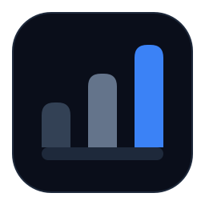

<div align="center">



# Agent Bench

### Framework-First Benchmarking for AI Agents

[](./LICENSE)
[](https://www.python.org/downloads/)
[](https://github.com/astral-sh/uv)
[](https://github.com/abubakarsiddik31/agent-bench/stargazers)

**Agent Bench** is an open-source benchmark suite for comparing AI agent frameworks side by side across **task performance** and **developer experience**.

[**Scoreboard**](#scoreboard) • [**Getting Started**](#getting-started) • [**Run a Benchmark**](#running-the-benchmark) • [**Contributing**](./CONTRIBUTING.md)

</div>

---

## Table of Contents

- [Why Agent Bench?](#why-agent-bench)
- [Scoreboard](#scoreboard)
- [Tool Metrics](#tool-metrics)
- [Framework Evaluation Notes](#framework-evaluation-notes)
- [Supported Frameworks](#supported-frameworks)
- [How Evaluation Works](#how-evaluation-works)
- [Getting Started](#getting-started)
- [Running the Benchmark](#running-the-benchmark)
- [Repository Structure](#repository-structure)
- [Community & Governance](#community--governance)
- [License](#license)

---

## Why Agent Bench?

Most AI benchmarks evaluate *models* in isolation. **Agent Bench is framework-first**: it helps engineering teams answer which agent framework is the best fit for real, multi-step production workflows when weighing both runtime reliability and engineering ergonomics.

Every framework implementation is evaluated on two equally weighted axes (**50% Task Score / 50% Framework Score**):

1. **Task Performance (50%)** — Can the agent reconcile noisy structured and unstructured evidence, follow operational guardrails, and produce contract-compliant artifacts?
2. **Framework & Developer Experience (50%)** — How ergonomic is tool definition, orchestration control flow, code volume (LOC), readability, extensibility, and trace observability?

---

## Scoreboard

Current public benchmark results on `intake-triage` (`stress_v1` split), ranked by **Final Score**:

| Rank | Framework | Runtime Model | Provider-Agnostic? | Framework LOC | Task Score | Framework Score | Final Score | Duration | Outcome |
| :---: | --- | --- | :---: | :---: | :---: | :---: | :---: | :---: | :---: |
| 1 | [Anthropic Agent SDK](./frameworks/anthropic-agent-sdk) | `sonnet-4.6` | `No` | `109` | `4.75 / 5.0` | `4.425 / 5.0` | **`4.588 / 5.0`** | `283.857s` | `Pass` |
| 2 | [OpenAI Agents SDK](./frameworks/openai-agents-sdk) | `gpt-5.4` | `Yes` | `202` | `4.75 / 5.0` | `4.33 / 5.0` | **`4.54 / 5.0`** | `72.222s` | `Pass` |
| 3 | [LangGraph](./frameworks/langgraph) | `gemini-3.1-pro-preview` | `Yes` | `225` | `4.25 / 5.0` | `4.3 / 5.0` | **`4.275 / 5.0`** | `73.916s` | `Pass` |
| 4 | [Pydantic AI](./frameworks/pydantic-ai) | `gpt-5.4` | `Yes` | `160` | `3.5 / 5.0` | `4.5 / 5.0` | **`4.0 / 5.0`** | `63.056s` | `Partial` |
| 5 | [Google ADK](./frameworks/google-adk) | `gemini-3.1-pro-preview` | `Yes` | `176` | `3.5 / 5.0` | `4.25 / 5.0` | **`3.875 / 5.0`** | `117.643s` | `Partial` |
| 6 | [LangGraph](./frameworks/langgraph) | `gpt-5.4` | `Yes` | `225` | `2.475 / 5.0` | `4.1 / 5.0` | **`3.287 / 5.0`** | `46.232s` | `Partial` |
| 7 | [Pydantic AI](./frameworks/pydantic-ai) | `gemini-3.1-pro-preview` | `Yes` | `160` | `2.475 / 5.0` | `4.05 / 5.0` | **`3.263 / 5.0`** | `172.726s` | `Partial` |
| 7 | [CrewAI](./frameworks/crewai) | `gpt-5.4` | `Yes` | `176` | `2.475 / 5.0` | `4.05 / 5.0` | **`3.263 / 5.0`** | `121.142s` | `Partial` |
| 9 | [AutoGen](./frameworks/autogen) | `gpt-5.4` | `Yes` | `195` | `2.475 / 5.0` | `3.5 / 5.0` | **`2.987 / 5.0`** | `35.261s` | `Partial` |

> **Notes:**
> - **Provider-Agnostic?** indicates whether the framework is designed as a general multi-provider runtime. Anthropic Agent SDK can authenticate through multiple Claude hosting providers (Anthropic API, Bedrock, Vertex), but remains Claude-specific.
> - **Framework LOC** counts non-empty, non-comment lines in `frameworks/<framework>/<task>/` excluding shared benchmark utilities in `common/` (per [`evaluation/metric-counting-policy.yml`](./evaluation/metric-counting-policy.yml)).
> - All runs above are evaluated with the locked `gemini-3.1-pro-preview` framework judge ([`evaluation/judge-model.yml`](./evaluation/judge-model.yml)) plus deterministic task scoring.

---

## Tool Metrics

Detailed tool-calling telemetry captured during each benchmark run:

| Framework | Run | Tool Pass | Total Calls | Passed Calls | Failed Calls | Unique Tools | Write Calls | Artifacts Produced | Success Rate | Write Completion | Output Coverage | Custom Tool Efficiency |
| --- | --- | :---: | :---: | :---: | :---: | :---: | :---: | :---: | :---: | :---: | :---: | :---: |
| Anthropic Agent SDK | `stress_v1/run-001` | `Pass` | `39` | `39` | `0` | `4` | `4` | `3 / 4` | `1.0` | `0.75` | `0.75` | `0.875` |
| OpenAI Agents SDK | `stress_v1/run-003` | `Pass` | `44` | `44` | `0` | `4` | `7` | `4 / 4` | `1.0` | `0.571` | `1.0` | `0.893` |
| LangGraph | `stress_v1/run-002` | `Pass` | `16` | `16` | `0` | `3` | `4` | `4 / 4` | `1.0` | `1.0` | `1.0` | `1.0` |
| Pydantic AI | `stress_v1/run-002` | `Pass` | `26` | `26` | `0` | `4` | `5` | `4 / 4` | `1.0` | `0.8` | `1.0` | `0.95` |
| Google ADK | `stress_v1/run-001` | `Pass` | `25` | `25` | `0` | `4` | `8` | `4 / 4` | `1.0` | `0.5` | `1.0` | `0.875` |
| LangGraph | `stress_v1/run-001` | `Pass` | `16` | `16` | `0` | `3` | `4` | `4 / 4` | `1.0` | `1.0` | `1.0` | `1.0` |
| Pydantic AI | `stress_v1/run-001` | `Pass` | `37` | `37` | `0` | `4` | `8` | `4 / 4` | `1.0` | `0.5` | `1.0` | `0.875` |
| CrewAI | `stress_v1/run-001` | `Pass` | `16` | `16` | `0` | `3` | `4` | `4 / 4` | `1.0` | `1.0` | `1.0` | `1.0` |
| AutoGen | `stress_v1/run-001` | `Pass` | `21` | `21` | `0` | `4` | `4` | `4 / 4` | `1.0` | `1.0` | `1.0` | `1.0` |

---

## Framework Evaluation Notes

Qualitative developer-experience takeaways synthesized from the benchmark implementations and judge evaluations:

- **Anthropic Agent SDK (`run-001`)**: Offers a remarkably concise developer experience (`109` LOC), particularly when leveraging its built-in file system and search tools (`Read`, `Write`, `Edit`, `Glob`, `Grep`). Orchestration is cleanly abstracted behind an async generator (`query` + `ClaudeAgentOptions`), though persistent custom trace formatting still requires manual message serialization.
- **OpenAI Agents SDK (`run-003`)**: Provides a clean, Pythonic approach to agent construction. Tool definition via `@function_tool` decorators, type hints, and docstrings is frictionless, and `Runner.run_sync` keeps turn management simple. While it exposes rich `new_items` and token usage on the result object, exporting custom JSONL traces requires light serialization glue.
- **LangGraph (`run-001`, `run-002`)**: Provides a structured, highly extensible state-graph architecture (`StateGraph`, `MessagesState`, `ToolNode`). Tool execution is rock-solid (`16/16` calls with `1.0` tool efficiency across both OpenAI and Gemini runs), and the graph mental model scales well to complex cyclic workflows, though manual message/usage extraction adds boilerplate when not using LangSmith.
- **Pydantic AI (`run-001`, `run-002`)**: Standout developer ergonomics (`160` LOC) thanks to type-safe `@agent.tool` decorators and `RunContext[AgentDeps]` dependency injection, which eliminates global state in tools. Switching between OpenAI and Gemini models is clean, and multi-turn continuation via `message_history` is straightforward.
- **Google ADK (`run-001`)**: Delivers a pragmatic single-agent setup (`LlmAgent` + `Runner` + `InMemorySessionService`) that converts plain typed Python functions directly into tools. Setup is compact (`176` LOC), with minor boilerplate around async session creation and iterating through runner events for final responses.
- **CrewAI (`run-001`)**: Features an intuitive declarative mental model (`Agent`, `Task`, `Crew`, `Process.sequential`) and clean `@tool` decorators (`176` LOC). However, enforcing strict multi-artifact output completion requires an external retry loop, and granular tool-call tracing requires manual instrumentation inside tools.
- **AutoGen (`run-001`)**: Uses a conversational dual-agent pattern (`AssistantAgent` + `UserProxyAgent`) with `Annotated` type hints for tool schemas (`195` LOC). While effective for multi-agent chat, registering each function across both a caller and executor feels heavier for single-agent artifact workflows, and structured tracing requires manual instrumentation.

---

## Supported Frameworks

### Implemented
| Framework | Package | Directory | Multi-Provider |
| --- | --- | --- | :---: |
| [Anthropic Agent SDK](https://docs.anthropic.com/en/docs/claude-code/sdk) | `claude-agent-sdk` | [`frameworks/anthropic-agent-sdk/`](./frameworks/anthropic-agent-sdk) | No (Claude) |
| [OpenAI Agents SDK](https://openai.github.io/openai-agents-python/) | `openai-agents` | [`frameworks/openai-agents-sdk/`](./frameworks/openai-agents-sdk) | Yes |
| [LangGraph](https://docs.langchain.com/oss/python/langgraph/overview) | `langgraph` | [`frameworks/langgraph/`](./frameworks/langgraph) | Yes |
| [Pydantic AI](https://ai.pydantic.dev/) | `pydantic-ai` | [`frameworks/pydantic-ai/`](./frameworks/pydantic-ai) | Yes |
| [Google ADK](https://google.github.io/adk-docs/) | `google-adk` | [`frameworks/google-adk/`](./frameworks/google-adk) | Yes |
| [CrewAI](https://docs.crewai.com/en/introduction) | `crewai` | [`frameworks/crewai/`](./frameworks/crewai) | Yes |
| [AutoGen](https://microsoft.github.io/autogen/stable/user-guide/core-user-guide/index.html) | `pyautogen` | [`frameworks/autogen/`](./frameworks/autogen) | Yes |

### Planned
- [Mastra](https://mastra.ai/) (TypeScript)
- Additional tasks from [`tasks/`](./tasks) (`archive-review`, `packet-drafting`, `portfolio-investigation`, `verification-sweep`)

---

## How Evaluation Works

Evaluation runs in two automated stages via [`evaluation/run_intake_benchmark.py`](./evaluation/run_intake_benchmark.py):

### 1. Deterministic Task Evaluation (`50%` of Final Score)
Handled by [`evaluation/evaluate_intake_run.py`](./evaluation/evaluate_intake_run.py) against [`rubrics/intake-triage.yml`](./rubrics/intake-triage.yml):
- **Hard Gates**: Verifies execution completion and presence of critical decision artifacts (`triage_decision.json`, `candidate_match_table.json`). Missing critical artifacts result in an automatic `fail` (`0.0`).
- **Quality Criteria & Weights**:
  - `matching_accuracy` (`25%`) — Exact disposition, best-match record ID, and top-ranked candidate accuracy against `gold-expected.json`.
  - `policy_application` (`20%`) — Explicit handling of contradictory signals, stale/reused references, and review guardrails.
  - `explanation_quality` (`20%`) — Evidence coverage and multi-point rationale clarity.
  - `gap_prioritization` (`15%`) — Accuracy of `must_have`, `later_required`, and `optional` missing field classifications.
  - `actionability` (`10%`) — Concrete immediate operational actions and review notes.
  - `confidence_calibration` (`10%`) — Alignment between stated confidence (`low`, `medium`, `high`) and evidence ambiguity.
- **Outcome Cap**: If any core semantic check (disposition, best match, or top candidate) misses the gold expectation, the task outcome is capped at `partial` (max `3.5 / 5.0`).

### 2. Framework Quality Evaluation (`50%` of Final Score)
Handled by [`evaluation/evaluate_framework.py`](./evaluation/evaluate_framework.py) against [`rubrics/framework-evaluation.yml`](./rubrics/framework-evaluation.yml):
- Combines deterministic code/trace metrics with qualitative assessment by the locked LLM judge (`gemini-3.1-pro-preview`, configured in [`evaluation/judge-model.yml`](./evaluation/judge-model.yml)).
- **Criteria & Weights**:
  - `tool_calling` (`20%`) — Ergonomics of tool definition/registration and runtime call reliability.
  - `orchestration` (`20%`) — Clarity and control of multi-step execution, state, and retry loops.
  - `human_review_quality` (`10%`) — Ease of inspecting outputs, traces, and agent behavior.
  - `ease_of_implementation` (`10%`) — Onboarding speed, setup steps, and API ergonomics.
  - `lines_of_code_required` (`10%`) — Deterministic score from non-comment LOC in framework-specific files (`<=120`: `5.0`, `<=200`: `4.0`, `<=300`: `3.0`, `<=450`: `2.0`).
  - `readability` (`10%`) — Clarity and maintainability of the framework implementation.
  - `extensibility` (`10%`) — Ease of adding new tools, tasks, or multi-agent steps.
  - `observability` (`10%`) — Built-in support for tracing, usage accounting, and debugging.

---

## Getting Started

### Prerequisites
- Python `3.10+`
- [`uv`](https://docs.astral.sh/uv/) package manager

### Installation

```bash
git clone https://github.com/abubakarsiddik31/agent-bench.git
cd agent-bench
uv sync
cp .env.example .env
```

Configure the relevant API keys in `.env`:

```dotenv
ANTHROPIC_API_KEY=your-anthropic-api-key
OPENAI_API_KEY=your-openai-api-key
GOOGLE_API_KEY=your-google-ai-studio-key
GEMINI_API_KEY=your-google-ai-studio-key
```

- `ANTHROPIC_API_KEY` — required for Anthropic Agent SDK runs
- `OPENAI_API_KEY` — required for OpenAI Agents SDK, and default OpenAI runs in LangGraph, Pydantic AI, CrewAI, and AutoGen
- `GOOGLE_API_KEY` / `GEMINI_API_KEY` — required for Google ADK runs, Gemini runs in LangGraph/Pydantic AI, and the `gemini-3.1-pro-preview` evaluation judge

---

## Running the Benchmark

All benchmark commands run from the repository root.

<details>
<summary><strong>Anthropic Agent SDK</strong></summary>

```bash
uv run python evaluation/run_intake_benchmark.py \
  --agent-script frameworks/anthropic-agent-sdk/intake-triage/agent.py \
  --fixture benchmarks/intake-triage/stress_v1/fixtures/case-101 \
  --out results/anthropic-agent-sdk/intake-triage/stress_v1/run-001
```

</details>

<details>
<summary><strong>OpenAI Agents SDK</strong></summary>

```bash
uv run python evaluation/run_intake_benchmark.py \
  --agent-script frameworks/openai-agents-sdk/intake-triage/agent.py \
  --fixture benchmarks/intake-triage/stress_v1/fixtures/case-101 \
  --out results/openai-agents-sdk/intake-triage/stress_v1/run-003
```

Defaults to `gpt-5.4` unless `OPENAI_AGENT_MODEL` or `OPENAI_MODEL` is set.

</details>

<details>
<summary><strong>LangGraph</strong></summary>

```bash
uv run python evaluation/run_intake_benchmark.py \
  --agent-script frameworks/langgraph/intake-triage/agent.py \
  --fixture benchmarks/intake-triage/stress_v1/fixtures/case-101 \
  --out results/langgraph/intake-triage/stress_v1/run-001
```

Defaults to `gpt-5.4` unless `LANGGRAPH_MODEL` or `OPENAI_MODEL` is set (supports `gemini-*` models via `LANGGRAPH_MODEL=gemini-3.1-pro-preview`).

</details>

<details>
<summary><strong>Pydantic AI</strong></summary>

```bash
uv run python evaluation/run_intake_benchmark.py \
  --agent-script frameworks/pydantic-ai/intake-triage/agent.py \
  --fixture benchmarks/intake-triage/stress_v1/fixtures/case-101 \
  --out results/pydantic-ai/intake-triage/stress_v1/run-002
```

Defaults to `gpt-5.4` unless `PYDANTIC_AI_MODEL` or `OPENAI_MODEL` is set (supports `gemini-*` models via `PYDANTIC_AI_MODEL=gemini-3.1-pro-preview`).

</details>

<details>
<summary><strong>Google ADK</strong></summary>

```bash
uv run python evaluation/run_intake_benchmark.py \
  --agent-script frameworks/google-adk/intake-triage/agent.py \
  --fixture benchmarks/intake-triage/stress_v1/fixtures/case-101 \
  --out results/google-adk/intake-triage/stress_v1/run-001
```

Defaults to `gemini-3.1-pro-preview` unless `GOOGLE_ADK_MODEL` or `GEMINI_MODEL` is set.

</details>

<details>
<summary><strong>CrewAI</strong></summary>

```bash
uv run python evaluation/run_intake_benchmark.py \
  --agent-script frameworks/crewai/intake-triage/agent.py \
  --fixture benchmarks/intake-triage/stress_v1/fixtures/case-101 \
  --out results/crewai/intake-triage/stress_v1/run-001
```

Defaults to `gpt-5.4` unless `CREWAI_MODEL` or `OPENAI_MODEL` is set.

</details>

<details>
<summary><strong>AutoGen</strong></summary>

```bash
uv run python evaluation/run_intake_benchmark.py \
  --agent-script frameworks/autogen/intake-triage/agent.py \
  --fixture benchmarks/intake-triage/stress_v1/fixtures/case-101 \
  --out results/autogen/intake-triage/stress_v1/run-001
```

Defaults to `gpt-5.4` unless `AUTOGEN_MODEL` or `OPENAI_MODEL` is set.

</details>

<details>
<summary><strong>Re-score an Existing Run (Skip Agent Execution)</strong></summary>

```bash
uv run python evaluation/run_intake_benchmark.py \
  --agent-script frameworks/anthropic-agent-sdk/intake-triage/agent.py \
  --fixture benchmarks/intake-triage/stress_v1/fixtures/case-101 \
  --out results/anthropic-agent-sdk/intake-triage/stress_v1/run-001 \
  --skip-agent
```

Add `--skip-judge` to use the deterministic heuristic fallback without calling the Gemini judge API.

</details>

<details>
<summary><strong>Run Task-Only or Framework-Only Evaluators</strong></summary>

```bash
# Task-only deterministic evaluation
uv run python evaluation/evaluate_intake_run.py \
  --run-dir results/anthropic-agent-sdk/intake-triage/stress_v1/run-001 \
  --fixture-dir benchmarks/intake-triage/stress_v1/fixtures/case-101

# Framework-only evaluation
uv run python evaluation/evaluate_framework.py \
  --run-dir results/anthropic-agent-sdk/intake-triage/stress_v1/run-001 \
  --fixture-dir benchmarks/intake-triage/stress_v1/fixtures/case-101 \
  --framework-dir frameworks/anthropic-agent-sdk/intake-triage
```

</details>

---

## Repository Structure

```text
.
├── .env.example
├── .gitignore
├── CODE_OF_CONDUCT.md
├── CONTRIBUTING.md
├── LICENSE
├── pyproject.toml
├── README.md
├── SECURITY.md
├── benchmarks/
│   ├── README.md
│   └── intake-triage/
│       ├── prompt-pack.yml
│       ├── fixtures/
│       └── stress_v1/
│           ├── prompt-pack.yml
│           └── fixtures/
├── common/
│   ├── benchmark_utils.py
│   └── evaluation_utils.py
├── evaluation/
│   ├── benchmark-execution.yml
│   ├── evaluate_framework.py
│   ├── evaluate_intake_run.py
│   ├── judge-model.yml
│   ├── metric-counting-policy.yml
│   ├── review-form.yml
│   └── run_intake_benchmark.py
├── frameworks/
│   ├── anthropic-agent-sdk/
│   │   ├── README.md
│   │   └── intake-triage/agent.py
│   ├── autogen/
│   │   ├── README.md
│   │   └── intake-triage/agent.py
│   ├── crewai/
│   │   ├── README.md
│   │   └── intake-triage/agent.py
│   ├── google-adk/
│   │   ├── README.md
│   │   └── intake-triage/agent.py
│   ├── langgraph/
│   │   ├── README.md
│   │   └── intake-triage/agent.py
│   ├── openai-agents-sdk/
│   │   ├── README.md
│   │   └── intake-triage/agent.py
│   └── pydantic-ai/
│       ├── README.md
│       └── intake-triage/agent.py
├── results/
│   └── README.md
├── rubrics/
│   ├── archive-review.yml
│   ├── framework-evaluation.yml
│   ├── intake-triage.yml
│   ├── packet-drafting.yml
│   ├── portfolio-investigation.yml
│   ├── shared-evaluation.yml
│   └── verification-sweep.yml
└── tasks/
    ├── archive-review.yml
    ├── intake-triage.yml
    ├── packet-drafting.yml
    ├── portfolio-investigation.yml
    └── verification-sweep.yml
```

---

## Community & Governance

- **Contributing Guide**: [CONTRIBUTING.md](./CONTRIBUTING.md)
- **Code of Conduct**: [CODE_OF_CONDUCT.md](./CODE_OF_CONDUCT.md)
- **Security Policy**: [SECURITY.md](./SECURITY.md)

---

## License

This project is released under the [MIT License](./LICENSE).
